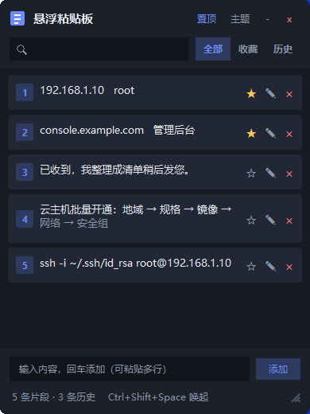

# CopyPad · 悬浮粘贴板

一个常驻屏幕角落的 Windows 悬浮粘贴板：把常用的文本片段放在手边，点一下即复制；同时自动记录最近复制过的内容，随时找回。

轻量、单文件、纯本地，不联网、不登录。




> **关于参考**：本项目的功能设计与交互参考了 [CopyQ](https://github.com/hluk/CopyQ)、[EcoPaste](https://github.com/EcoPasteHub/EcoPaste)、[Ditto](https://github.com/sabrogden/Ditto) 等优秀开源剪贴板工具，**代码为独立实现**（技术栈为 Python + tkinter，与上述项目不同），未复制其源代码。详见文末「参考与致谢」。

---

## 特性

**片段库（核心）**
- 悬浮卡片窗口，可拖动、缩放、置顶，位置与尺寸自动记忆
- 逐行管理常用文本：新增（支持一次粘贴多行）、编辑、删除、搜索过滤
- 收藏置顶、自定义标签、拖拽左侧序号调整顺序

**剪贴板历史**
- 自动记录最近复制过的文字，默认保留 200 条，可随时关闭
- 自动跳过私钥、Token、JWT、密码字段等高敏感内容，不写入历史
- 历史条目点星标即可转为长期保留的固定片段

**效率操作**
- `Ctrl+Shift+Space` 在任何软件里显示 / 隐藏窗口
- `Ctrl+Alt+1~9` 直接复制第 N 条，不必打开窗口
- 单击复制；双击或 `Ctrl+Enter` 复制并粘贴回刚才的窗口
- `↑` `↓` 选择、`Enter` 复制、`F2` 编辑、`Delete` 删除、`Esc` 隐藏

**系统集成**
- 系统托盘常驻，右键菜单可开关置顶 / 自动记录 / 深浅主题 / 开机自启
- 单实例运行；重复启动会唤起已有窗口
- 导入 / 导出片段为 `.txt`
- 深色 / 浅色主题

---

## 下载

到 [Releases](../../releases) 下载 `CopyPad.exe`，双击即用，无需安装。

> 由于未做代码签名，首次运行时 Windows 可能弹出「已保护你的电脑」提示：点 **更多信息 → 仍要运行** 即可。
> 如果介意，也可以用源码自行构建。

## 使用

1. 双击 `CopyPad.exe`，窗口出现在屏幕右上角；
2. 在底部输入框输入内容并回车，即新增一条片段；
3. 点某一行复制；双击则复制并直接粘贴到刚才的窗口；
4. 托盘图标右键可切换设置；`Esc` 把窗口收进托盘。

数据保存在 `%LOCALAPPDATA%\CopyPad\data.json`，首次启动会自动尝试导入旧版 `items.txt`（一行一条）。

## 快捷键

| 快捷键 | 功能 |
| --- | --- |
| `Ctrl+Shift+Space` | 全局显示 / 隐藏窗口 |
| `Ctrl+Alt+1~9` | 直接复制第 N 条 |
| `↑` / `↓` | 选择条目 |
| `Enter` | 复制选中条目 |
| `Ctrl+Enter` | 复制并粘贴 |
| `F2` | 编辑选中条目 |
| `Delete` | 删除选中条目 |
| `Ctrl+F` | 聚焦搜索框 |
| `Ctrl+N` | 聚焦底部输入框 |
| `Esc` | 隐藏到托盘 |

## 隐私

- 所有数据仅保存在本机 `%LOCALAPPDATA%\CopyPad\`，不上传、不联网
- 无账号、无统计、无遥测
- 敏感内容（私钥、常见 Token 前缀、JWT、`password=` 等）默认不进入历史记录
- 不主动读取剪贴板以外任何内容

## 从源码构建

环境：Windows 10/11 + Python 3.10+（开发使用 3.14）。

```bat
python -m pip install -r requirements.txt
build.cmd
```

产物：`src\dist\CopyPad.exe`（单文件，约 13 MB）。

也可以手动执行：

```bat
cd src
python gen_assets.py
python -m PyInstaller --noconfirm --clean --onefile --noconsole ^
  --name CopyPad --icon app.ico --add-data "app.ico;." ^
  --version-file version.txt CopyPadApp.py
```

## 技术栈

| 部分 | 方案 |
| --- | --- |
| 界面 | Python + tkinter（Canvas 自绘圆角卡片、深色主题） |
| 窗口能力 | pywin32 / ctypes（无边框圆角、置顶、全局热键、托盘、单实例） |
| 剪贴板 | Win32 剪贴板 API + 序列号轮询 |
| 图标资源 | Pillow 生成多尺寸 `.ico` |
| 打包 | PyInstaller `--onefile --noconsole` |

---

## 更新日志

**v2.0.1**

- 修复拖动缩放时窗口闪烁：拖动期间不再逐帧重设圆角裁剪（`SetWindowRgn` 会触发整窗重绘），改为松手时恢复；连续 mousemove 合并为每 16ms 一次重排，一次拖动的重绘次数从约 60 次降到 12 次
- 最小窗口高度改为按顶栏/底栏实测高度计算，最小尺寸下只占约 1.5 行记录（原先固定高度会露出 3 行）；底栏输入框与状态栏在小尺寸下不再被挤出可视区

**v2.0.0**

- 首个版本：悬浮粘贴板、片段管理、复制历史、全局热键、托盘、深色/浅色主题

---

## 参考与致谢

本项目的**产品形态与交互细节**参考了以下开源项目。它们的技术栈、实现方式与本项目完全不同，本项目未复制任何源代码，仅在功能取舍与使用体验上学习：

| 项目 | Star | 许可证 | 借鉴点 |
| --- | --- | --- | --- |
| [CopyQ](https://github.com/hluk/CopyQ) | ~12.6k | GPL-3.0 | 剪贴板历史 + 搜索 + 标签 + 全局热键的产品结构 |
| [EcoPaste](https://github.com/EcoPasteHub/EcoPaste) | ~7.6k | Apache-2.0 | 现代深色 UI、收藏与分组、敏感内容过滤、本地优先 |
| [Ditto](https://github.com/sabrogden/Ditto) | ~7.5k | GPL-3.0 | Windows 剪贴板历史的使用习惯与快捷键设计 |

感谢以上项目的作者与社区。若你认为本项目在某处借鉴过度，欢迎提 Issue，我会调整或移除相关内容。

本项目与上述项目无任何隶属或授权关系，相关名称与商标归各自所有者。

## 许可证

[MIT](LICENSE) © 2026 Gnw04

## 免责声明

本软件按「现状」提供，不附带任何明示或暗示的担保。剪贴板内容可能包含敏感信息，请自行评估使用场景；建议不要在不受信任的共享电脑上保存敏感片段。
